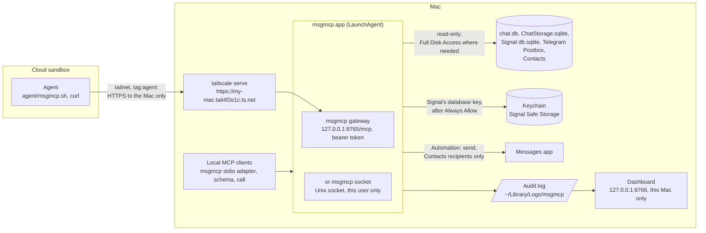
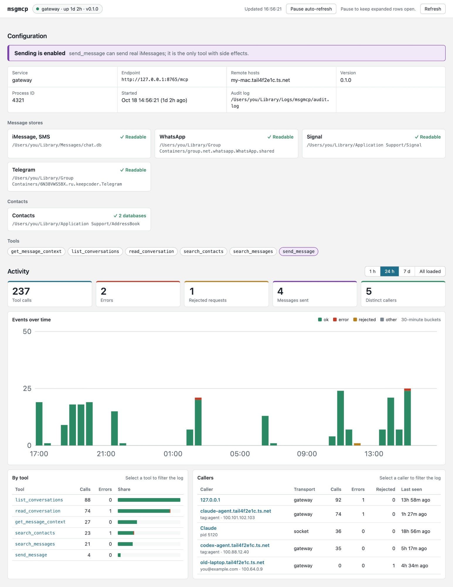

# msgmcp

A local MCP server, written in Rust, for message history on a Mac. It reads iMessage
and SMS from `chat.db`, WhatsApp Desktop from its `ChatStorage.sqlite`, Signal Desktop
from its encrypted `db.sqlite` and Telegram for macOS from its encrypted Postbox cache, all
read-only, looks people up in Contacts, WhatsApp's address book, Signal conversations and
Telegram's contacts, and sends iMessage text through the Messages app.

## The problem

Agents increasingly run in cloud sandboxes (Claude, Codex, Grok and others), but your
iMessages, texts, WhatsApp, Signal and Telegram chats and contacts live on your Mac.
msgmcp reads their local data; macOS protects some of it with Full Disk Access. An
agent that could answer "what did Sarah say about Saturday?" or draft a reply has no way
to see them.

The obvious ways to bridge that gap are unsafe:

- **Uploading the databases** hands over every conversation you've ever had, to keep
  somewhere you don't control.
- **Opening the Mac to the agent**, through SSH or an exposed port, gives it far more than
  your messages, and anything that hijacks the agent gets the same.
- **Letting it send freely** means a stranger's message, read by the agent, can steer it
  into texting anyone.

msgmcp gives a cloud agent a narrow door instead. One signed app on the Mac holds the
permissions and offers a few tools: search, list and read conversations, look up
contacts, and send an iMessage. Agents reach it only over your private Tailscale network, where they're tagged
and limited to that one port, and every request needs a token. The databases are opened
read-only, results carry names from your Contacts, sending is off for remote agents
unless you enable it and then reaches only people saved in Contacts, and every call lands in an audit log on the Mac. [Security](#security) lists
what this keeps out and what it doesn't.

## Architecture



- **One privileged process.** Only `~/Applications/msgmcp.app`, run by a LaunchAgent,
  holds the macOS permissions and opens the databases. Everything else, local or remote,
  is a client of it, and no client can do more than the tools allow.
- **Two services, same tools.** The LaunchAgent runs one of them:
  - `msgmcp gateway` (the default): MCP over HTTP at `http://127.0.0.1:8765/mcp`, with a
    bearer token, for clients that can't reach a local socket.
  - `msgmcp socket`: MCP on a Unix socket that only processes running as your user can open.
- **Local clients** run the same binary with no arguments as a stdio adapter; scripts use
  `msgmcp schema` and `msgmcp call`. They use the socket if it exists, otherwise the gateway.
- **Remote access is two locks.** The tailnet policy lets devices tagged `tag:agent`
  reach only port 443 on the Mac, where `tailscale serve` forwards to the gateway; the
  gateway then requires its bearer token. Remote agents can send only to people saved in
  Contacts, after you approve a draft, and every call lands in an audit log.
- **Agents set themselves up.** A sandbox agent follows [agent/README.md](agent/README.md),
  which joins the tailnet without root and checks the whole path, including that it really
  is restricted, before it reads anything.

## Install

[SETUP.md](SETUP.md) is the step-by-step runbook, from a fresh checkout to a cloud agent
connected, with a check for each step. An agent on the Mac can work through it with you.

In short, `python3 scripts/reinstall.py --sign "<certificate>" --source imessage` builds
the release binary, installs `~/Applications/msgmcp.app` and its LaunchAgent, and checks
that the service can read the selected stores. The sources are `imessage` (iMessage and
SMS), `whatsapp`, `signal` and `telegram`. Repeat `--source` for each store you choose;
the service reads only those message stores and Contacts. List only the apps you want
agents to see
(without `--source`, a first install lists the stores it found and stops). The first time,
grant **msgmcp** Full Disk Access (to read `chat.db` and WhatsApp's and Telegram's group
containers; Signal doesn't need it) and run it again. When it serves Signal, the script also runs
`msgmcp --check-signal`, and macOS asks once whether msgmcp may use "Signal Safe
Storage" from the Keychain: choose Always Allow. Signal encrypts its database with a key
that only that Keychain item unlocks, and the service never shows that dialog itself, so
until it's allowed Signal is reported as unavailable. Automation → Messages (to send) is
requested on the first send.

**To reinstall after changes**, run `python3 scripts/reinstall.py` with no arguments. It reuses
the installed app's certificate, stores and service options, so macOS keeps its grants.
`--source NAME` (repeatable) replaces the installed stores. Options: `--service socket`,
`--allow-host my-mac.tail4f2e1c.ts.net`, `--allow-send` (needs iMessage); passing any of them
replaces the installed set. Restart MCP clients afterwards to pick up tool changes. An
install from before `--source` keeps serving iMessage and WhatsApp until you choose.

macOS ties privacy grants to the app's signature, so the script refuses an ad hoc signature,
which changes with every build. After switching certificates, macOS drops Full Disk Access
and it has to be granted again.
`python3 scripts/install_service.py --uninstall` removes the app and LaunchAgent.

## Connect a client

### Apps on this Mac

The adapter command is always `/Users/<you>/Applications/msgmcp.app/Contents/MacOS/msgmcp`.

- **Claude Desktop**: add the entry below to `~/Library/Application Support/Claude/claude_desktop_config.json`,
  then quit the app with ⌘Q and reopen it. Its tools then appear as `msgmcp__*`; in
  cloud sessions linked to the Mac they appear as `mcp__remote-devices__msgmcp__*`.
  ```json
  "mcpServers": { "msgmcp": { "command": "/Users/<you>/Applications/msgmcp.app/Contents/MacOS/msgmcp" } }
  ```
- **Codex**: `codex mcp add msgmcp -- "$HOME/Applications/msgmcp.app/Contents/MacOS/msgmcp"`
- **Claude Code**: `claude mcp add msgmcp -- "$HOME/Applications/msgmcp.app/Contents/MacOS/msgmcp"`

The service describes its own tools, so they aren't documented by hand. To see them, or to
call one from a script:

```sh
msgmcp schema
msgmcp call list_conversations '{"query": "sarah"}'
```

### A cloud agent

Follow parts 2 and 3 of [SETUP.md](SETUP.md). The agent gets four environment variables
([.env.example](.env.example)) and a short instruction to fetch the public repository and
follow [agent/README.md](agent/README.md) each session. It then joins the tailnet,
checks that it is restricted, and reads the tool list itself; nothing about the tools
needs to be pasted in.

## Remote access

The gateway listens on `127.0.0.1` only. To reach it from elsewhere, publish it on a private
network with `tailscale serve`, and reinstall with `--allow-host` so the gateway accepts the
proxied `Host` header ([SETUP.md](SETUP.md), steps 5–7). Requests from web pages (an
`Origin` header) are refused.

The tailnet policy gives `tag:agent` only `tcp:443` on the Mac, and sandboxes join with a
reusable, ephemeral auth key tagged `tag:agent` ([SETUP.md](SETUP.md), steps 8–9). A device
that joins untagged counts as one of your own devices and gets your access.

Every request needs `Authorization: Bearer <token>`. The gateway creates a random token in
`~/Library/Application Support/MSGMCP/gateway.token` (mode 0600) on first start; delete the
file and restart the service to rotate it. The gateway is stateless, so an agent without MCP
can POST one JSON-RPC message:

```sh
curl -s https://my-mac.tail4f2e1c.ts.net/mcp -H "Authorization: Bearer $MSGMCP_TOKEN" \
  -H 'Content-Type: application/json' -H 'Accept: application/json, text/event-stream' \
  -d '{"jsonrpc":"2.0","id":1,"method":"tools/call","params":{"name":"list_conversations","arguments":{"limit":5}}}'
```

**Sending.** Message text is written by whoever sent it, so treat it as untrusted input to
an agent. `send_message` stays off on the gateway unless it runs with `--allow-send`, and on
every service it sends only to phone numbers and email addresses saved in Contacts. That
stops an agent steered by a stranger's message from texting the stranger. A number saved
without a country code counts as North American (`+1`), as Messages dials it. A success
means submitted, not delivered; never retry a send automatically.

**Audit log.** Both services append one JSON line per tool call to
`~/Library/Logs/msgmcp/audit.log` (Console.app shows it under Log Reports): the time,
service, caller, tool, arguments, outcome and any error. The gateway also logs requests it
refuses. Sent message text is logged as an argument; what tools return is never logged. The
log rotates at 10 MB and keeps five old files.

The caller is the tailnet device behind the gateway (its address, name, and tags or owner,
from `tailscale whois`, cached for ten minutes), `127.0.0.1` for apps on this Mac using the
gateway directly, or for socket clients the process and the program that started it.

```sh
tail -f ~/Library/Logs/msgmcp/audit.log
```

The [audit dashboard](#audit-dashboard) shows the same log as a summary you can filter.

## Audit dashboard



*The dashboard showing made-up data from `?demo=1`.*

The service also serves a web page at <http://127.0.0.1:8766/> for reviewing who has been
using it and what they did. There's nothing to start: it is up whenever the service is.

- **Configuration:** the endpoint, the remote host names, whether sending is on, the tools
  offered, and whether each message store and Contacts can be read right now.
- **Activity:** for the last hour, day or week, or everything loaded: tool calls, errors,
  rejected requests, messages sent and distinct callers; a chart over time; and tables by
  tool and by caller. Select a tool or caller to filter the event log.
- **Event log:** every event in the [audit log](#remote-access), filterable by text,
  outcome, caller and tool. Select a row to see the whole event.

The page is plain HTML that the service builds on each request, with no scripts, and it
reloads itself every 30 seconds; pause that to keep rows open. `/api/status` and `/api/log`
return the same data as JSON. `?demo=1` shows the page with made-up data instead of yours,
for screenshots like the one above.

The dashboard listens on loopback only and refuses any `Host` but its own, so neither the
tailnet (`tailscale serve` forwards only the gateway's port) nor web pages (through DNS
rebinding) can read it. It needs no key, so anything else that reaches this Mac's loopback
can ([Security](#security)). `--dashboard ADDRESS` moves it to another loopback address; if
its port is taken, the service logs that and keeps serving MCP without it.

## Security

**Kept out:** the internet. The gateway listens on `127.0.0.1`, `tailscale serve` exposes it
to your tailnet only (never use Funnel), agent devices may reach only port 443, and every
request needs the token. Databases are read-only; sending reaches Apple Contacts only, and
every call is in the [audit log](#remote-access).

**Not kept out:**

- **What people text you.** It can steer an agent into leaking what it reads, or, with
  `--allow-send`, texting your contacts. Approving drafts is the agent's rule, not the server's.
- **WhatsApp, Signal and Telegram names.** Senders choose their profile names, so a stranger
  can show up as "Mom". Telegram chats from strangers you never wrote to are marked
  `filtered`, but the mark is a heuristic.
- **Signal's encryption at rest.** Once allowed, msgmcp can read Signal's database key, so
  anything that controls msgmcp can read your Signal history, as with `chat.db`.
- **Telegram's encryption at rest.** Without a local passcode, Telegram for macOS encrypts
  its database with a key anyone who can read its group container can unlock, msgmcp
  included. With Passcode Lock on, msgmcp reports Telegram as unavailable.
- **Your address book.** `search_contacts` needs a query but returns anyone who matches,
  so an agent can read most of your contacts with a few short queries.
- **Your accounts.** The agent platform, GitHub and Tailscale can each let someone in.
- **Programs running as you.** They can read the token and use the socket.
- **Anything that reaches this Mac's loopback.** The dashboard has no key, so other
  accounts on the Mac, sandboxed apps, containers and VMs that can reach `127.0.0.1` can
  read the audit log through it: who asked what, and the text of every message sent.

## Limits

This is a proof of concept for the current Messages, WhatsApp Desktop, Signal Desktop and
Telegram for macOS data formats, which can change without notice. Signal Desktop updates
often; msgmcp reads only columns and JSON fields that Signal's own queries use. Signal
can only be read, not sent to.

Telegram support reads the native Telegram for macOS app (App Store or direct download),
not Telegram Desktop, which keeps no history on disk. Its database is a cache of what the
app has loaded: older history the app never fetched is missing, and it is only as current
as the app's last sync. msgmcp decodes Telegram's undocumented Postbox format, following
Telegram's open-source client; a Telegram update that changes it shows up as
`decode_failed` messages or an unavailable store.

## License

GPL-3.0-or-later. Text decoding uses [crabstep](https://github.com/ReagentX/crabstep).
`scripts/fixtures/attributed_body` is crabstep 0.7.0's `AttributedBodyTextOnly` test fixture.
