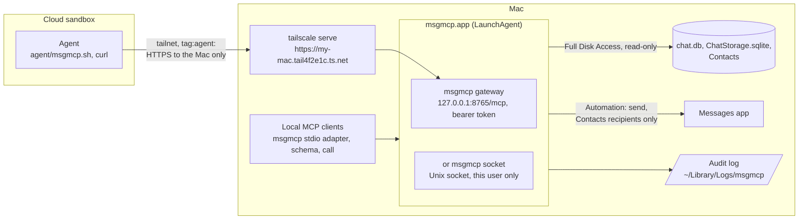

# msgmcp

A local MCP server, written in Rust, for message history on a Mac. It reads iMessage
and SMS from `chat.db` and WhatsApp Desktop from its `ChatStorage.sqlite`, both
read-only, and sends iMessage text through the Messages app.

## Architecture



- **One privileged process.** Only `~/Applications/msgmcp.app`, run by a LaunchAgent,
  holds the macOS permissions and opens the databases. Everything else, local or remote,
  is a client of it, and no client can do more than the tools allow.
- **Two services, same tools.** The LaunchAgent runs one of them:
  - `msgmcp gateway` (the default): MCP over HTTP at `http://127.0.0.1:8765/mcp`, with a
    bearer token, for clients that can't reach a local socket.
  - `msgmcp socket`: MCP on a Unix socket that only processes running as your user can open.
- **Local clients** run the same binary with no arguments as a stdio adapter; scripts use
  `msgmcp schema` and `msgmcp call`. They use the socket if it exists, otherwise the gateway.
- **Remote access is two locks.** The tailnet policy lets devices tagged `tag:agent`
  reach only port 443 on the Mac, where `tailscale serve` forwards to the gateway; the
  gateway then requires its bearer token. Remote agents can send only to people saved in
  Contacts, after you approve a draft, and every call lands in an audit log.
- **Agents set themselves up.** A sandbox agent follows [agent/README.md](agent/README.md),
  which joins the tailnet without root and checks the whole path, including that it really
  is restricted, before it reads anything.

## Install

[SETUP.md](SETUP.md) is the step-by-step runbook, from a fresh checkout to a cloud agent
connected, with a check for each step. An agent on the Mac can work through it with you.

In short, `python3 scripts/reinstall.py --sign "<certificate>"` builds the release binary,
installs `~/Applications/msgmcp.app` and its LaunchAgent, and checks that the service can
read both stores. The first time, grant **msgmcp** Full Disk Access (to read `chat.db` and
WhatsApp's group container) and run it again. Automation → Messages (to send) is requested
on the first send.

**To reinstall after changes**, run `python3 scripts/reinstall.py` with no arguments. It reuses
the installed app's certificate and service options, so macOS keeps its grants. Options:
`--service socket`, `--allow-host my-mac.tail4f2e1c.ts.net`, `--allow-send`; passing any of them
replaces the installed set. Restart MCP clients afterwards to pick up tool changes.

macOS ties privacy grants to the app's signature, so the script refuses an ad hoc signature,
which changes with every build. After switching certificates, macOS drops Full Disk Access
and it has to be granted again.
`python3 scripts/install_service.py --uninstall` removes the app and LaunchAgent.

## Connect a client

### Apps on this Mac

The adapter command is always `/Users/<you>/Applications/msgmcp.app/Contents/MacOS/msgmcp`.

- **Claude Desktop**: add the entry below to `~/Library/Application Support/Claude/claude_desktop_config.json`,
  then quit the app with ⌘Q and reopen it. Its tools then appear as `msgmcp__*`; in
  cloud sessions linked to the Mac they appear as `mcp__remote-devices__msgmcp__*`.
  ```json
  "mcpServers": { "msgmcp": { "command": "/Users/<you>/Applications/msgmcp.app/Contents/MacOS/msgmcp" } }
  ```
- **Codex**: `codex mcp add msgmcp -- "$HOME/Applications/msgmcp.app/Contents/MacOS/msgmcp"`
- **Claude Code**: `claude mcp add msgmcp -- "$HOME/Applications/msgmcp.app/Contents/MacOS/msgmcp"`

The service describes its own tools, so they aren't documented by hand. To see them, or to
call one from a script:

```sh
msgmcp schema
msgmcp call list_conversations '{"query": "sarah"}'
```

### A cloud agent

Follow parts 2 and 3 of [SETUP.md](SETUP.md). The agent gets four environment variables
([.env.example](.env.example)), read access to this repository, and a short instruction
to follow [agent/README.md](agent/README.md) each session. It then joins the tailnet,
checks that it is restricted, and reads the tool list itself; nothing about the tools
needs to be pasted in.

## Remote access

The gateway listens on `127.0.0.1` only. To reach it from elsewhere, publish it on a private
network with `tailscale serve`, and reinstall with `--allow-host` so the gateway accepts the
proxied `Host` header ([SETUP.md](SETUP.md), steps 5–7). Requests from web pages (an
`Origin` header) are refused.

The tailnet policy gives `tag:agent` only `tcp:443` on the Mac, and sandboxes join with a
reusable, ephemeral auth key tagged `tag:agent` ([SETUP.md](SETUP.md), steps 8–9). A device
that joins untagged counts as one of your own devices and gets your access.

Every request needs `Authorization: Bearer <token>`. The gateway creates a random token in
`~/Library/Application Support/MSGMCP/gateway.token` (mode 0600) on first start; delete the
file and restart the service to rotate it. The gateway is stateless, so an agent without MCP
can POST one JSON-RPC message:

```sh
curl -s https://my-mac.tail4f2e1c.ts.net/mcp -H "Authorization: Bearer $MSGMCP_TOKEN" \
  -H 'Content-Type: application/json' -H 'Accept: application/json, text/event-stream' \
  -d '{"jsonrpc":"2.0","id":1,"method":"tools/call","params":{"name":"list_conversations","arguments":{"limit":5}}}'
```

**Sending.** Message text is written by whoever sent it, so treat it as untrusted input to
an agent. `send_message` stays off on the gateway unless it runs with `--allow-send`, and on
every service it sends only to phone numbers and email addresses saved in Contacts. That
stops an agent steered by a stranger's message from texting the stranger. A number saved
without a country code counts as North American (`+1`), as Messages dials it. A success
means submitted, not delivered; never retry a send automatically.

**Audit log.** Both services append one JSON line per tool call to
`~/Library/Logs/msgmcp/audit.log` (Console.app shows it under Log Reports): the time,
service, caller, tool, arguments, outcome and any error. The gateway also logs requests it
refuses. Sent message text is logged as an argument; what tools return is never logged. The
log rotates at 10 MB and keeps five old files.

The caller is the tailnet device behind the gateway (its address, name, and tags or owner,
from `tailscale whois`, cached for ten minutes), `127.0.0.1` for apps on this Mac using the
gateway directly, or for socket clients the process and the program that started it.

```sh
tail -f ~/Library/Logs/msgmcp/audit.log
```

## Security

**Kept out:** the internet. The gateway listens on `127.0.0.1`, `tailscale serve` exposes it
to your tailnet only (never use Funnel), agent devices may reach only port 443, and every
request needs the token. Databases are read-only; sending reaches Apple Contacts only, and
every call is in the [audit log](#remote-access).

**Not kept out:**

- **What people text you.** It can steer an agent into leaking what it reads, or, with
  `--allow-send`, texting your contacts. Approving drafts is the agent's rule, not the server's.
- **WhatsApp names.** Senders choose them, so a stranger can show up as "Mom".
- **Your accounts.** The agent platform, GitHub and Tailscale can each let someone in.
- **Programs running as you.** They can read the token and use the socket.

## Limits

This is a proof of concept for the current macOS `chat.db` and WhatsApp Desktop schemas,
which can change without notice.

## License

GPL-3.0-or-later. Text decoding uses [crabstep](https://github.com/ReagentX/crabstep).
`scripts/fixtures/attributed_body` is crabstep 0.7.0's `AttributedBodyTextOnly` test fixture.
